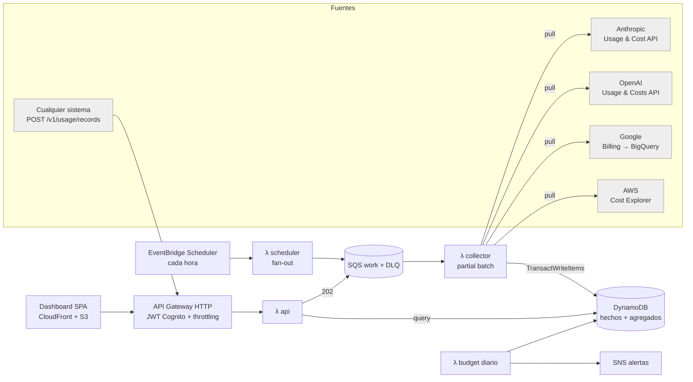

# UsageHub

**Observabilidad centralizada de consumo de IA y nube (FinOps).** Un solo dashboard para saber
cuánto gasta la organización en **Claude (Anthropic)**, **OpenAI**, **Gemini (Google)**, **AWS** o
cualquier otro sistema, y **quién** de cada equipo lo consume.

[](.github/workflows/ci.yml)


> Prototipo (PoC) del proyecto de Arquitectura de Software, Arquitectura Empresarial y Gobierno de TI.
> Los artefactos de arquitectura (C4, ADR, escenarios de calidad, TOGAF/COBIT) y el artículo
> están en el repositorio hermano [`usage-hub-architecture`](../usage-hub-architecture).

## El reto técnico

Los proveedores entregan datos de consumo **tarde (4-24 h), revisables y en formatos distintos**,
y AWS SQS entrega mensajes **al menos una vez**. Sumar ingenuamente cada lectura duplica el gasto
reportado. UsageHub implementa un **ledger idempotente con deltas** sobre DynamoDB:

- cada hecho tiene una clave natural determinista (`tenant|provider|service|principal|día`);
- un *upsert* calcula la diferencia entre la versión anterior y la nueva (`domain/ledger.py`);
- hecho + deltas de agregados se escriben en **una transacción** con **control de concurrencia
  optimista** (`version = :v`) y reintentos con *full jitter* (`adapters/dynamodb.py`).

Resultado: **efecto exactamente-una-vez** sobre los agregados, verificado con pruebas basadas en
propiedades (Hypothesis) y con pruebas de carga que inyectan 15 % de duplicados.

## Arquitectura



| Capa | Paquete | Patrones |
|---|---|---|
| Dominio | `usage_hub.domain` | Modelo canónico, *Value Objects*, puertos (hexagonal) |
| Aplicación | `usage_hub.services` | Casos de uso, CQRS (modelo de lectura agregado) |
| Conectores | `usage_hub.connectors` | Adapter + Strategy + Registry (plug-in, Open/Closed) |
| Infraestructura | `usage_hub.adapters` | Repository, Optimistic Concurrency, Retry + Jitter |
| Entrada | `usage_hub.handlers` | Composition Root, Competing Consumers, DLQ |

## Inicio rápido (sin AWS)

```bash
python -m venv .venv && source .venv/bin/activate   # Windows: .venv\Scripts\activate
pip install -e ".[dev]"
python scripts/local_server.py                       # abrir http://localhost:8080
```

## Uso

UsageHub tiene dos espacios, que se eligen en la barra superior:

| Espacio | Para qué |
|---|---|
| **Empresa** | Consumo de IA y nube de la organización (APIs de Anthropic, OpenAI, AWS, Google, Claude Code) con atribución por persona y equipo, presupuestos, y **licencias SaaS** (Slack, GitHub, Microsoft 365, Claude Team…) con número de usuarios. |
| **Personal** | **Mis suscripciones**: todo lo que pagas cada mes o cada año, sea IA (ChatGPT, Claude, Gemini) o no (Netflix, HBO Max, Disney+, Spotify, YouTube Premium, iCloud, gimnasio…), con su **fecha de cobro**. Es privado: cada persona ve solo lo suyo. |

**Mis suscripciones** muestra:
- el gasto mensual equivalente (un plan anual cuenta 1/12 por mes);
- los cobros del mes y cuánto falta por cobrar;
- el próximo cobro, con aviso si faltan 3 días o menos;
- la proyección anual, un calendario del mes y el gasto por categoría.

Cada suscripción se guarda en su moneda (USD, COP, MXN, EUR…) y los totales se muestran por moneda, sin
convertir ni inventar tipos de cambio. Las fechas siguientes se calculan solas desde la fecha de cobro que
ingresas: un cobro el día 31 cae el último día de los meses más cortos. También se pueden exportar a CSV.

### Empresa

La aplicación tiene dos vistas, que se eligen arriba a la izquierda:

| Vista | Qué muestra |
|---|---|
| **Datos reales** | El consumo de *tu* organización. Al principio está vacía e invita a conectar fuentes. |
| **Ejemplo** | Una organización ficticia (tenant `demo`, solo lectura) para explorar el producto. |

Desde **Datos reales → Configuración**:

1. **Conexiones:** elige el proveedor (Claude, OpenAI, AWS, Google o el generador de prueba), pega la credencial
   que pide el formulario, pulsa *Probar conexión* (lee los últimos 3 días sin guardar nada) y luego *Guardar y
   sincronizar*. Cada conexión muestra su último sync, cuántos registros trajo y el error si lo hubo.
2. **Personas y equipos:** lista las identidades técnicas detectadas (usuarios, API keys, proyectos, tags), con
   las no asignadas primero y el porcentaje de gasto ya atribuido. Asígnalas a una persona y un equipo.
3. **Presupuestos:** límite mensual por equipo (y opcionalmente por proveedor), con alertas al 50/80/100 %.
4. **Ingesta por API:** endpoint y ejemplo `curl` para que *cualquier* otro sistema reporte consumo.

Las credenciales **nunca vuelven al navegador**. En AWS se guardan en Secrets Manager (`usagehub/{tenant}/…`);
en local, en `~/.usagehub/` (o `$USAGEHUB_HOME`), fuera del repositorio. Al reiniciar el servidor local, la
configuración se conserva y los últimos 30 días se resincronizan solos.

| Proveedor | Qué credencial pide |
|---|---|
| Anthropic (Claude) | API key con alcance de **organización** (no de espacio de trabajo) ligada a un usuario admin o cuenta de servicio, o una Admin key `sk-ant-admin…` |
| OpenAI | Admin key `sk-admin-…` (owner de la organización) |
| AWS | Nada en local (usa tu perfil de AWS CLI) u opcionalmente un rol a asumir con External ID |
| Google | Service account JSON + tabla de la exportación de facturación a BigQuery (`pip install -e ".[gcp]"`) |
| Claude Code (este equipo) | Nada: lee los registros locales de `~/.claude/projects` (tokens exactos; costo = equivalente en API, estimado) |

### Consumo con suscripción (claude.ai, Claude Code Pro/Max)

Los planes individuales y Team no tienen API de uso. UsageHub los cubre de dos maneras:

- **Claude Code:** el conector *Claude Code (este equipo)* lee las sesiones locales, deduplica las respuestas
  (una misma respuesta aparece en varias líneas al transmitirse) y calcula el **costo equivalente en API** con la
  tabla de `connectors/pricing.py`. Sirve para comparar uso y valor; lo que pagas es la tarifa del plan.
  En un equipo, cada persona envía su consumo a la instancia central:

  ```bash
  python scripts/push_claude_code.py --api https://<api> --token "$TOKEN" --user ana@empresa.com --days 7
  ```
- **Tarifa del plan (claude.ai, ChatGPT, Gemini…):** se registra en *Personal → Mis suscripciones* (o, si la paga
  la empresa, en *Empresa → Configuración → Licencias y suscripciones*).

## Calidad

```bash
make check          # ruff + mypy --strict + pytest (unitarias, integración con moto, propiedades)
```

| Métrica | Valor |
|---|---|
| Pruebas | 120 (unitarias, integración con DynamoDB/SQS/SNS/Secrets emulados, Hypothesis) |
| Cobertura de ramas | 96,2 % (umbral de CI: 80 %) |
| Tipado | `mypy --strict` sin errores |
| Lint | `ruff` (reglas E, F, B, S/bandit, PL, UP, SIM, PT...) |

## Despliegue en AWS

```bash
python scripts/build_lambda.py            # dist/app.zip + dist/layer.zip para Lambda arm64
cd infra/terraform/envs/dev && cp terraform.tfvars.example terraform.tfvars
terraform init && terraform apply
```

Pasos completos (alta de usuarios, conectores, alarmas): [docs/runbook.md](docs/runbook.md).
Modelo de amenazas: [docs/security.md](docs/security.md). Contrato de la API: [docs/openapi.yaml](docs/openapi.yaml).

## Pruebas de estrés

| Herramienta | Uso |
|---|---|
| [`tests/load/k6_ingest.js`](tests/load/k6_ingest.js) | Escenarios `load`, `stress`, `spike`, `soak` contra la ruta de escritura en AWS |
| [`tests/load/k6_dashboard.js`](tests/load/k6_dashboard.js) | Carga sobre el modelo de lectura |
| [`scripts/loadgen.py`](scripts/loadgen.py) | Generador Python con inyección de duplicados y **verificación de consistencia** |

```bash
make load-test SCENARIO=stress BASE_URL=https://<api> TOKEN=<access_token_m2m>
python scripts/loadgen.py --base-url https://<api> --token <token> --scenario spike --rps 100 --duration 300
```

Los resultados medidos están en [`docs/results/`](docs/results/).

## Estructura

```
src/usage_hub/
  domain/        modelo canónico, ledger (deltas), puertos
  services/      ingesta, dashboard (CQRS), presupuestos
  connectors/    anthropic_admin, openai_admin, aws_cost_explorer, google_billing, synthetic
  adapters/      dynamodb (single-table), aws (SQS/SNS/Secrets), memory
  handlers/      api, collector, scheduler, budget (+ bootstrap = composition root)
frontend/        SPA sin build step (Chart.js), OAuth2 PKCE con Cognito
infra/terraform/ módulos reutilizables (lambda_function, sqs_queue, static_site, cost_reader_role) + envs/dev
tests/           unit/, integration/ (moto), load/ (k6)
scripts/         local_server, build_lambda, loadgen
```

## Agregar un proveedor nuevo

1. Crear `src/usage_hub/connectors/<proveedor>.py` con una clase que implemente `fetch(tenant_id, window)`
   y devuelva `UsageRecord`.
2. Registrar la fábrica con `@register(Provider.X)` y añadir el módulo a `_LAZY_MODULES`.
3. Escribir la prueba de contrato con una respuesta grabada del proveedor.

Ningún otro componente cambia: ni el ledger, ni la API, ni el dashboard.

## Licencia

MIT
